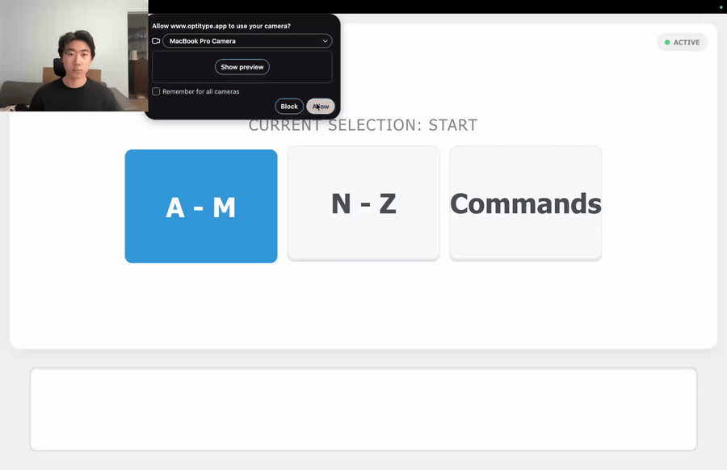

# Optitype

**An extensible, gaze-controlled keyboard that runs on an ordinary 480p webcam.**

Optitype lets you type using only your eyes, with no eye-tracking hardware or high-resolution camera required. Instead of asking for pixel-precise gaze, it splits the keyboard into a few large targets (**A–M**, **N–Z**, and **Commands**) and narrows down your choice step by step, so it stays reliable even with low-quality video.

## Demo

